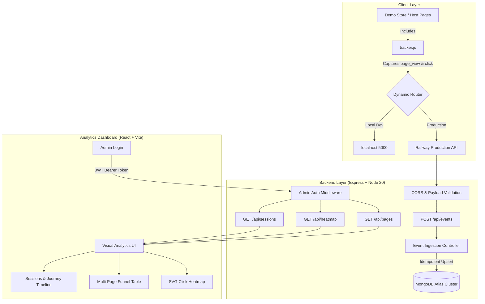

# CausalFunnel User Analytics Platform

[](https://nodejs.org/)
[](https://react.dev/)
[](https://expressjs.com/)
[](https://www.mongodb.com/atlas)
[](https://railway.app/)
[](https://vercel.com/)
[](https://opensource.org/licenses/ISC)

A production-grade, full-stack web analytics platform engineered for high-accuracy client event tracking, session replay exploration, multi-page funnel analysis, and viewport-normalized click heatmaps.

---

## 🌐 Live Production Deployments

| Component | Target Platform | Live URL / Endpoint |
|---|---|---|
| **Backend REST API** | Railway | `https://useranalytics-production.up.railway.app` |
| **API Health Check** | Railway | [`https://useranalytics-production.up.railway.app/api/health`](https://useranalytics-production.up.railway.app/api/health) |
| **Analytics Dashboard** | Vercel | Configured with `VITE_API_URL` pointing to Railway |
| **Interactive Demo Store** | Vercel / Railway | Available at `/demo/index.html` (bundled with live tracker) |
| **Database** | MongoDB Atlas | AWS us-east-1 cluster with replica set & SSL/TLS |

### 🔐 Administrator Credentials
To access protected analytics endpoints and the React dashboard:
- **Username**: `admin`
- **Password**: `admin123`

---

## ✨ Key Features

### 1. Lightweight Client-Side Tracker (`tracker.js`)
- **Zero-Dependency & Non-Blocking**: Pure Vanilla JavaScript with asynchronous `fetch` delivery (`keepalive: true`) and graceful error isolation.
- **Session Management**: Automatically provisions and persists a persistent RFC4122 v4 UUID in `localStorage` across all page navigations.
- **Strict Data Privacy**: Collects only interaction metadata (`page_view` and `click`). Zero sensitive data collection (no passwords, form fields, keystrokes, or PII).
- **Coordinate Normalization**: Captures viewport dimensions (`viewport_width`, `viewport_height`) alongside click coordinates (`clientX`, `clientY`) to render responsive, resolution-independent heatmaps.

### 2. High-Performance Express API & MongoDB Ingestion
- **Idempotent Ingestion**: Guarantees exactly-once processing using unique indexes on `event_id`. Duplicate network retries return HTTP `200` without duplicating database records.
- **Optimized Compound Indexes**:
  - `{ event_id: 1 }` (Unique constraint)
  - `{ session_id: 1, timestamp: 1 }` (Sub-millisecond chronological session timeline extraction)
  - `{ event_type: 1, page_url: 1 }` (High-speed heatmap and multi-page aggregations)
- **Centralized Security & Error Handling**: Strict payload validation (size-capped at 50KB), CORS domain filtering, safe equality admin auth, and centralized error middleware.

### 3. Modern React 18 + Vite Analytics Dashboard
- **Sessions & User Journey Timeline**: Chronological event breakdown per visitor session with live duration calculations, event counters, and status badges.
- **Multi-Page Funnel Analysis**: High-level page analytics aggregating total pageviews, unique visitors, total clicks, and drop-off rates across product catalog, cart, and checkout.
- **Interactive Click Heatmap**: SVG-powered heatmap overlay projecting user clicks onto viewport previews with visual density gradients.
- **One-Click Demo Store Launch**: Header action button to launch the live demo store in a separate tab to generate live real-time interaction data.

---

## 🏛️ System Architecture



---

## 📁 Repository Structure

```text
causalfunnel-analytics/
├── client/
│   ├── dashboard/                # React 18 + Vite Analytics Dashboard
│   │   ├── src/
│   │   │   ├── components/       # UI Components (Heatmap, SessionList, EventTimeline, etc.)
│   │   │   ├── pages/            # Dashboard view & authentication screens
│   │   │   ├── services/         # Centralized API service layer with JWT injection
│   │   │   ├── index.css         # Minimalist design system
│   │   │   └── App.jsx           # Main React root application
│   │   ├── public/               # Bundled static demo store & tracker
│   │   ├── vercel.json           # Vercel SPA routing rules
│   │   └── package.json          # Frontend build dependencies
│   └── vercel.json               # Intermediate Vercel monorepo configuration
│
├── server/                       # Express.js REST API
│   ├── src/
│   │   ├── config/               # Database connection with WebCrypto polyfill
│   │   ├── controllers/          # Event, Session, Heatmap, Page & Auth controllers
│   │   ├── middleware/           # JWT auth, validation, and error handler
│   │   ├── models/               # Mongoose Event schema and compound indexes
│   │   ├── routes/               # Express routing tables
│   │   ├── app.js                # Express app setup, CORS, and static file serving
│   │   └── server.js             # Entry point & graceful shutdown handling
│   ├── test-integration.js       # End-to-end backend integration test suite
│   ├── package.json              # Backend dependencies (pinned Node >= 20.0.0)
│   └── .env.example              # Environment variables template
│
├── tracker/                      # Standalone Client Tracker
│   └── tracker.js                # Vanilla JS tracking script
│
├── demo/                         # 4-Page E-Commerce Demonstration Store
│   ├── index.html                # Storefront catalog
│   ├── product.html              # Product detail page
│   ├── cart.html                 # Shopping cart
│   └── checkout.html             # Order checkout page
│
├── architecture.md               # Source of Truth Architectural Specification
├── railway.json                  # Railway deployment configuration
├── vercel.json                   # Root Vercel deployment configuration
└── README.md                     # Platform Documentation
```

---

## 📡 REST API Reference

### 1. Ingestion & Health (Public)

#### `GET /api/health`
Verifies backend status and database connectivity.
- **Response `200 OK`**:
  ```json
  { "status": "ok", "database": "connected" }
  ```

#### `POST /api/events`
Ingests an interaction event. Idempotent based on `event_id`.
- **Payload (`page_view`)**:
  ```json
  {
    "event_id": "c1f72782-bdfa-4938-bdcf-884976c726cb",
    "session_id": "a548231c-3be0-4497-b676-9cf7203ab3d0",
    "event_type": "page_view",
    "page_url": "https://myapp.vercel.app/demo/index.html",
    "timestamp": "2026-10-15T10:00:00.000Z"
  }
  ```
- **Payload (`click`)**:
  ```json
  {
    "event_id": "e7b0ca41-0f7e-46ea-9a84-0a3fe7a7526a",
    "session_id": "a548231c-3be0-4497-b676-9cf7203ab3d0",
    "event_type": "click",
    "page_url": "https://myapp.vercel.app/demo/index.html",
    "timestamp": "2026-10-15T10:00:05.000Z",
    "x": 482,
    "y": 320,
    "viewport_width": 1440,
    "viewport_height": 900
  }
  ```
- **Response `201 Created`**:
  ```json
  { "success": true, "event_id": "e7b0ca41-0f7e-46ea-9a84-0a3fe7a7526a" }
  ```

---

### 2. Administrator Authentication

#### `POST /api/auth/login`
Validates admin credentials and issues a signed JWT session token.
- **Request**: `{ "username": "admin", "password": "admin123" }`
- **Response `200 OK`**:
  ```json
  {
    "success": true,
    "token": "eyJhbGciOiJIUzI1NiIsIn...",
    "user": { "username": "admin", "role": "admin" }
  }
  ```

#### `GET /api/auth/me`
Verifies the current Bearer token.
- **Header**: `Authorization: Bearer <token>`
- **Response `200 OK`**: `{ "success": true, "user": { "username": "admin" } }`

---

### 3. Analytics & Aggregations (Requires Bearer Token)

#### `GET /api/sessions`
Returns paginated list of sessions aggregated with event counts, start times, and durations.
- **Query Params**: `page` (default: 1), `limit` (default: 20)
- **Response `200 OK`**:
  ```json
  {
    "sessions": [
      {
        "session_id": "a548231c-3be0-4497-b676-9cf7203ab3d0",
        "start_time": "2026-10-15T10:00:00.000Z",
        "end_time": "2026-10-15T10:04:12.000Z",
        "event_count": 8,
        "first_page": "https://myapp.vercel.app/demo/index.html"
      }
    ],
    "pagination": { "total": 45, "page": 1, "limit": 20, "pages": 3 }
  }
  ```

#### `GET /api/sessions/:sessionId/events`
Returns all events for a given session sorted chronologically.
- **Response `200 OK`**:
  ```json
  {
    "session_id": "a548231c-3be0-4497-b676-9cf7203ab3d0",
    "total_events": 8,
    "events": [...]
  }
  ```

#### `GET /api/heatmap?page_url=<URL>`
Returns click coordinate clusters for a given page URL with normalization factors.
- **Response `200 OK`**:
  ```json
  {
    "page_url": "https://myapp.vercel.app/demo/index.html",
    "total_clicks": 34,
    "clicks": [
      {
        "x": 482,
        "y": 320,
        "viewport_width": 1440,
        "viewport_height": 900,
        "normalized_x": 0.3347,
        "normalized_y": 0.3556,
        "timestamp": "2026-10-15T10:00:05.000Z"
      }
    ]
  }
  ```

#### `GET /api/pages`
Aggregates performance and visitor counts across all tracked URLs.
- **Response `200 OK`**:
  ```json
  {
    "total_pages": 4,
    "pages": [
      {
        "page_url": "/demo/index.html",
        "total_views": 120,
        "total_clicks": 85,
        "unique_sessions": 32
      }
    ]
  }
  ```

---

## 💻 Local Development Setup

### Prerequisites
- [Node.js](https://nodejs.org/) `>= 20.0.0`
- [npm](https://npmjs.com/) `>= 9.0.0`
- MongoDB local instance or MongoDB Atlas connection URI

### 1. Clone & Configure Backend

```bash
# Clone the repository
git clone https://github.com/Akhil0045/UserAnalytics.git
cd UserAnalytics

# Install server dependencies
cd server
npm install

# Create environment configuration
cp .env.example .env
```

Edit `server/.env`:
```ini
PORT=5000
MONGODB_URI=mongodb://localhost:27017/causalfunnel
# Or use MongoDB Atlas:
# MONGODB_URI=mongodb+srv://<username>:<password>@cluster0.oce86ck.mongodb.net/causalfunnel?retryWrites=true&w=majority
CLIENT_ORIGIN=http://localhost:5173
JWT_SECRET=development_super_secret_jwt_key
ADMIN_USERNAME=admin
ADMIN_PASSWORD=admin123
```

Start the backend:
```bash
npm run dev
# Server listening on http://0.0.0.0:5000
```

### 2. Configure & Start Dashboard

In a new terminal window:

```bash
cd client/dashboard
npm install

# Create frontend environment file
cp .env.example .env
```

Edit `client/dashboard/.env`:
```ini
VITE_API_URL=http://localhost:5000
```

Start the Vite development server:
```bash
npm run dev
# Dashboard accessible at http://localhost:5173
```

### 3. Running Integration Tests

To run the complete automated 11-step end-to-end integration test suite verifying health, auth, event ingestion, idempotency, sessions, timelines, heatmaps, and page aggregations:

```bash
cd server
npm run test:integration
```

Expected output:
```text
========================================
🚀 Starting CausalFunnel Integration Tests
📡 Target API: http://localhost:5000
========================================

  ✅ PASS: GET /api/health returns ok status and connected database
  ✅ PASS: GET /api/sessions without Authorization header is rejected with HTTP 401
  ✅ PASS: POST /api/auth/login succeeds with admin credentials and issues Bearer token
  ✅ PASS: GET /api/auth/me validates Bearer token
  ✅ PASS: POST /api/events ingests page_view with HTTP 201
  ✅ PASS: POST /api/events ingests click with viewport coordinates with HTTP 201
  ✅ PASS: POST /api/events handles duplicate event_id idempotently without throwing error
  ✅ PASS: GET /api/sessions aggregates test session with correct event_count = 2
  ✅ PASS: GET /api/sessions/:sessionId/events returns all session events chronologically
  ✅ PASS: GET /api/heatmap?page_url=... returns ingested click coordinates and viewport
  ✅ PASS: GET /api/pages aggregates multi-page views, clicks, and session metrics

========================================
📊 Integration Results: 11 Passed, 0 Failed
========================================
```

---

## 🚀 Deployment Guide

### Backend Deployment (Railway)
1. Fork or push this repository to GitHub.
2. In [Railway](https://railway.app/), create a **New Project** > **Deploy from GitHub repo**.
3. In **Settings**:
   - The included `railway.json` and `Procfile` automatically manage builds and startup.
   - Under **Networking**, click **Generate Domain** to get your public API URL.
4. Under **Variables**, add:
   - `MONGODB_URI`: Your MongoDB Atlas connection string.
   - `JWT_SECRET`: A secure random secret string.
   - `ADMIN_USERNAME`: `admin`
   - `ADMIN_PASSWORD`: `admin123`
   - `CLIENT_ORIGIN`: `https://<your-vercel-domain>.vercel.app`

### Frontend Deployment (Vercel)
1. In [Vercel](https://vercel.com/), click **Add New...** > **Project** and select this repo.
2. Framework Preset: **Vite**.
3. Under **Environment Variables**, add:
   - `VITE_API_URL`: `https://<your-railway-subdomain>.up.railway.app`
4. Click **Deploy**.
5. Once live, open the dashboard, log in with `admin` / `admin123`, and click **Demo Store ↗** to begin generating live user analytics!

---

## 🔒 Security & Best Practices

- **Zero PII Exposure**: The tracker strictly rejects capturing passwords, form text inputs, credit cards, or keystrokes.
- **Idempotency by Design**: MongoDB unique indexes enforce exactly-once ingestion semantics at the database layer.
- **CORS Protection**: Access to protected session data is strictly restricted to designated dashboard origins and authenticated JWT sessions.
- **Fail-Safe Client Tracker**: Network errors, ad-blockers, or server timeouts in `tracker.js` are caught silently with zero impact on the host application's DOM or user experience.

---

## 📄 License
This project is licensed under the [ISC License](LICENSE).
